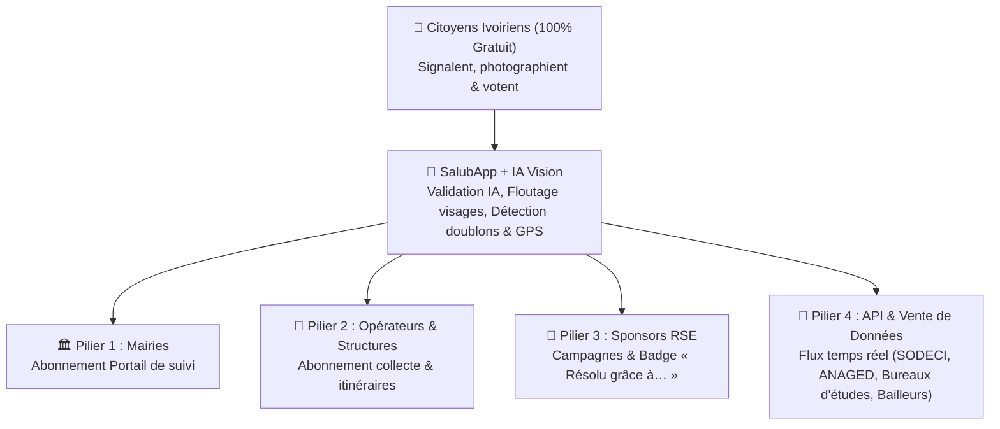

# Modèle Économique SalubApp : Les 4 Piliers de Rentabilisation

> [!IMPORTANT]
> **Principe fondamental :** L'application reste **100 % gratuite pour les citoyens** afin de maximiser le nombre de signalements sur le terrain. La monétisation repose sur **4 piliers complémentaires** :
> 1. **Les Mairies & Collectivités** (Abonnement de pilotage territorial)
> 2. **Les Opérateurs de ramassage & Structures** (Abonnement opérationnel terrain)
> 3. **Le Sponsoring Entreprises / RSE** (Campagnes financées & visibilité citoyenne)
> 4. **L'API & la Vente de Données Urbaines** (Monétisation de la donnée géolocalisée et anonymisée)

---

## Pilier 1 : Les Mairies & Collectivités (Abonnement SaaS)
- **Ce qu'elles achètent :** L'accès au Portail Structures (`/dashboard`) pour visualiser en temps réel la carte des déchets et la carte thermique de leur commune, prioriser les urgences citoyennes et prouver à la population que la mairie agit (passage du statut à « En cours » puis « Résolu », ce qui verrouille les votes).
- **Modèle de revenu :** Abonnement mensuel ou annuel par commune (**150 000 à 500 000 FCFA / mois** selon la taille de la commune).

---

## Pilier 2 : Les Opérateurs de ramassage & Structures d'assainissement
- **Cibles :** PME de pré-collecte, sociétés de ramassage d'ordures, entreprises de curage de caniveaux, ONG financées.
- **Ce qu'ils achètent :**
  - La géolocalisation exacte des tas d'ordures et points noirs avec itinéraire Google Maps direct pour optimiser les tournées de leurs camions et tricycles.
  - La preuve d'intervention certifiée (statut « Résolu » horodaté) pour facturer leurs prestations aux mairies ou aux bailleurs.
- **Modèle de revenu :** Abonnement mensuel (**100 000 à 300 000 FCFA / mois**) ou commission sur les marchés d'intervention attribués via la plateforme.

---

## Pilier 3 : Le Sponsoring Entreprises / RSE
- **Cibles :**
  - Producteurs de boissons, eau et emballages (*Solibra, Brassivoire, Céleste, Olgane, Nestlé…*).
  - Télécoms, Mobile Money, Banques & Grandes surfaces (*Orange, MTN, Moov, Wave, SGCI, NSIA, Prosuma…*).
- **Les 3 formules vendues aux Sponsors :**
  1. **Le badge « ✅ Résolu grâce au soutien de [Sponsor] » :** Le sponsor finance le ramassage d'un lot de dépotoirs. Sur chaque carte de signalement nettoyé, les habitants du quartier voient que c'est cette marque qui a financé la résolution.
  2. **Le Sponsoring d'une Commune (« Commune Propre ») :** Présence du sponsor sur la carte et le filtre d'une commune (*« Initiative Salubrité Yopougon soutenue par [Sponsor] »*).
  3. **Campagne « Coup de Propre » + Rapport RSE certifié :** Opération ciblée sur les zones rouges de la carte thermique, avec remise d'un rapport chiffré (statistiques GPS + photos avant/après) pour le bilan RSE annuel de l'entreprise (**1 000 000 à 5 000 000 FCFA / campagne**).

---

## Pilier 4 : API & Vente de Données Urbaines (Data-as-a-Service)

Grâce aux citoyens et à l'IA (Gemini Vision), SalubApp constitue **la seule base de données en temps réel sur l'insalubrité, l'état de la voirie et les risques urbains à Abidjan**.

### 1. Quelles données sont vendues (et comment) ?
- **Flux API en temps réel (JSON / GeoJSON / Webhooks) :** Permet à un client de connecter directement son propre logiciel cartographique (SIG) à SalubApp pour recevoir automatiquement les alertes qualifiées par catégorie, commune et niveau d'urgence.
- **Exports & Rapports analytiques (CSV / PDF / Datasets) :** Historique des points noirs récurrents, cartographie des caniveaux bouchés et zones d'eau stagnante (risques d'inondation), temps moyen de résolution par quartier, typologie des déchets.

### 2. Qui achète l'API et les données ?
| Client potentiel | Pourquoi ils achètent la donnée SalubApp | Format vendu | Tarif indicatif |
|---|---|---|---|
| **Concessionnaires de services publics (SODECI, CIE, ANAGED, ONAD)** | Recevoir en temps réel dans leur système les signalements de **fuites d'eau (`fuite_sodeci`)**, d'eaux usées, de caniveaux obstrués ou de dépôts sauvages avant que les dégâts ne s'aggravent | **Licence API temps réel** (flux automatique par catégorie) | **300 000 – 1 000 000 FCFA / mois** (contrat annuel) |
| **Bureaux d'études (Urbanisme, BTP, Environnement)** | Réaliser des études d'impact environnemental, préparer des chantiers de voirie ou de drainage pluvial avec de vraies données terrain | **Achat de jeux de données (Datasets)** par commune ou période | **500 000 – 2 000 000 FCFA** par étude / dataset |
| **Bailleurs internationaux & Programmes (Banque Mondiale, AFD, PNUD, ONU-Habitat)** | Mesurer scientifiquement l'impact des programmes d'assainissement, identifier les quartiers prioritaires contre les inondations et le paludisme (eaux stagnantes) | **Accès API + Rapports trimestriels d'observatoire urbain** | **2 000 000 – 10 000 000 FCFA / an** |
| **Assurances, Immobilier & Logistique** | Connaître les zones à risque d'inondation, d'emprise de chaussée ou de voirie dégradée à Abidjan | **API Cartographique** | Abonnement API selon le volume de requêtes |

### 3. Pourquoi cette vente de données est 100 % légale et éthique ?
- **Zéro donnée personnelle vendue :** Les signalements sont anonymes et notre IA floute automatiquement tous les visages sur les photos avant stockage.
- **Donnée 100 % urbaine et qualifiée :** Ce qui est vendu, ce n'est pas l'identité des citoyens, mais **l'état physique de la ville** (position GPS du déchet/fuite, catégorie validée par l'IA, score de confirmation citoyenne et historique de résolution).

---

## Vue d'ensemble du Modèle Économique (Les 4 Piliers)

